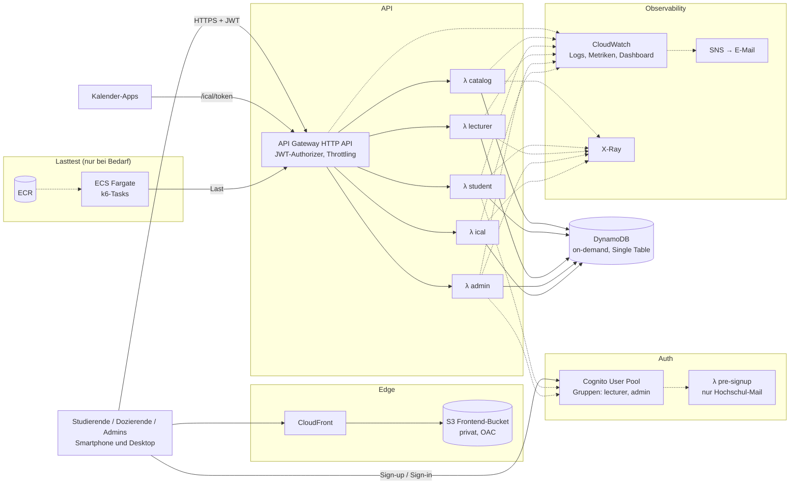

# SPLAN for Mobile

Stundenplan-App für die Hochschule Heilbronn, ähnlich SPLAN, aber mobile-first: persönlicher Stundenplan,
sichtbare Ausfälle und Raumänderungen, iCal-Abo. Semesterprojekt Cloud Computing, Abgabe 18.01.2027.

- Aufgabenstellung: [`docs/assignment.md`](docs/assignment.md)
- Architekturentscheidungen: [`docs/decisions/`](docs/decisions/)
- Roadmap: [`docs/roadmap.md`](docs/roadmap.md)

## Architecture

### Problemdefinition

| Problem mit SPLAN | Unsere Lösung |
|---|---|
| Tabellenansicht auf dem Smartphone kaum nutzbar | Mobile-first Tages- und Wochenansicht als PWA |
| Studiengang/Semester muss jedes Mal neu gefiltert werden | Kurse einmal abonnieren → persönlicher Plan nach Login |
| Ausfälle und Raumänderungen fallen nicht auf | Markierung direkt im Plan; Dozierende pflegen ihre Termine selbst |
| Kein Kalender-Export | Persönlicher iCal-Abo-Link für Google/Apple/Outlook |

**Zielgruppen und Rollen:** Studierende (Plan lesen, Kurse abonnieren), Dozierende (eigene Termine absagen,
Raum ändern), Admins (Kurse, Termine, Räume, Rollen pflegen).

**MVP:** alles oben. **Nice-to-have:** Push-/E-Mail-Benachrichtigungen, Offline-Cache.

### Cloud-Provider

AWS in `eu-central-1` (Frankfurt), siehe [ADR 0001](docs/decisions/0001-aws-eu-central-1.md): Daten bleiben in der EU,
breitestes Serverless-Angebot mit echtem Scale-to-Zero (Lambda, DynamoDB on-demand, Cognito), großzügiges Free Tier,
eigener Account mit 100 € Credits.

### Übersicht



### Container vs. Managed Services

| Komponente | Wahl | Begründung |
|---|---|---|
| API | Lambda + API Gateway | Sporadische, stark schwankende Last (morgens Spitzen, nachts nichts) → Scale-to-Zero, 0 € im Idle |
| Datenbank | DynamoDB on-demand | Einfache Zugriffsmuster, kein VPC nötig (→ kein NAT Gateway), skaliert ohne Konfiguration |
| Frontend | S3 + CloudFront | Statische SPA, Cent-Beträge |
| Auth | Cognito | Managed Identity Provider, kein eigener Passwort-Code |
| Lastgenerator | **ECS Fargate (Container)** | Lang laufende, CPU-lastige Batch-Arbeit, horizontal auf N Tasks verteilbar, läuft nur während eines Tests |

Details: [ADR 0002](docs/decisions/0002-serverless-core-fargate-loadgen.md).

### Datenmodell

Single-Table-Design in DynamoDB ([ADR 0003](docs/decisions/0003-dynamodb-single-table.md)): Kurse, Termine
(mit Status `scheduled | cancelled | room_changed`), Abos, iCal-Tokens. Gepflegt über die Admin-UI, Startdaten per
Seed-Skript (realistischer Studiengang SEB, keine echten Personendaten).

- TODO: Architektur nach jedem Meilenstein aktualisieren

## Infrastructure as Code

Terraform (>= 1.10) verwaltet die gesamte Infrastruktur ([ADR 0004](docs/decisions/0004-terraform-s3-native-locking-bootstrap.md)).

```
infra/
  bootstrap/         State-Bucket (S3, Versionierung, native Locking) + GitHub-OIDC-Rolle; lokaler State
  modules/           auth, api, data, frontend, monitoring, loadtest
  envs/dev, envs/prod  Root-Module mit eigenem State-Key und tfvars
```

**Setup auf leerem Account**

```bash
cd infra/bootstrap && terraform init && terraform apply   # einmal pro Account
cd infra/envs/dev  && terraform init && terraform apply
```

**Teardown:** `terraform destroy` in `envs/<env>`, zuletzt optional in `bootstrap/`. Buckets und ECR sind mit
`force_destroy`/`force_delete` konfiguriert, damit kein manueller Schritt nötig ist.

**CI/CD** mit GitHub Actions und OIDC, ohne langlebige Access Keys ([ADR 0005](docs/decisions/0005-github-actions-oidc.md)):

| Ereignis | Aktion |
|---|---|
| Pull Request | Lint, Tests, `terraform plan` als PR-Kommentar |
| Merge auf `main` | `terraform apply` dev + Frontend-Deploy |
| Tag `v*` | `terraform apply` prod nach manueller Freigabe |

- TODO: Ablauf `apply` → `destroy` → `apply` auf frischem Account einmal durchspielen und hier dokumentieren

## Security

### Benutzer und Rollen

Cognito User Pool ([ADR 0006](docs/decisions/0006-cognito-groups-authorization.md)):

| Rolle | Wie man sie bekommt | Darf |
|---|---|---|
| Student | Self-Sign-up mit Hochschul-Mail (Pre-Sign-up-Lambda prüft die Domain) | Katalog lesen, Kurse abonnieren, eigenen Plan und iCal-Link, Account löschen |
| Dozent (`lecturer`) | Admin weist Gruppe zu | zusätzlich: **eigene** Termine absagen, Raum ändern |
| Admin (`admin`) | Seed-Skript / anderer Admin | Kurse, Termine, Räume, Rollen verwalten |

### Autorisierung

1. API Gateway: JWT-Authorizer prüft Signatur, Ablauf, Audience. Ohne gültiges Token kein Lambda-Aufruf.
2. Lambda: prüft die Gruppe aus `cognito:groups` und bei Dozierenden den Besitz (`course.lecturerId == sub`).
3. iCal: Kalender-Apps können kein JWT senden → geheime Token-URL pro User, nur als Hash gespeichert, neu erzeugbar
   ([ADR 0007](docs/decisions/0007-ical-token-urls.md)).

### Least Privilege und Zero Trust

- Eine IAM-Rolle pro Lambda ([ADR 0008](docs/decisions/0008-lambda-per-domain.md)), z. B. `ical` nur `dynamodb:GetItem/Query`.
- CI-Rolle per OIDC, auf Repo und Branch/Environment eingeschränkt.
- Kein Vertrauen aufgrund des Netzwerks: jede Anfrage wird authentifiziert und autorisiert; S3-Bucket nur über CloudFront (OAC).
- Keine Secrets im Repo; falls nötig SSM Parameter Store.
- Bewusst weggelassen: AWS WAF (Grundgebühr), stattdessen API-Gateway-Throttling ([ADR 0011](docs/decisions/0011-no-waf-no-nat.md)).

### Datenschutz (DSGVO)

Gespeichert werden nur E-Mail (Cognito), User-ID, Abos und iCal-Token-Hash, alles in `eu-central-1`.
„Account löschen“ entfernt Cognito-User, Abos und Token. Logs enthalten keine personenbezogenen Daten (30 Tage Retention).

- TODO: IAM-Policies je Rolle als Tabelle ergänzen, sobald sie in Terraform stehen

## Monitoring

CloudWatch und X-Ray ([ADR 0010](docs/decisions/0010-cloudwatch-xray-monitoring.md)):

- **Logs:** strukturiertes JSON (Powertools), Korrelation über Request-ID, 30 Tage Retention
- **Tracing:** X-Ray von API Gateway über Lambda bis DynamoDB
- **Dashboard** (eins pro Umgebung, per Terraform): Requests, 4xx/5xx, p50/p95/p99-Latenz, Lambda-Concurrency,
  Throttles, Cold Starts, DynamoDB-Consumed-Capacity
- **Alarme → SNS → E-Mail:**

| Alarm | Schwelle (vorläufig) |
|---|---|
| API 5xx-Rate | > 1 % über 5 min |
| API p95-Latenz | > 1 s über 5 min |
| Lambda Errors / Throttles | > 0 über 5 min |
| AWS Budget | 10 / 25 / 50 € |

- TODO: Screenshot Dashboard, Beispiel-Trace, ausgelöster Alarm

## User Experience

React-PWA mit Vite, Tailwind und shadcn/ui ([ADR 0009](docs/decisions/0009-react-pwa-shadcn.md)).

- **Studierenden-App (mobile-first):** Tagesansicht als Standard, Wischen zwischen Tagen, Wochenansicht,
  Ausfälle/Raumänderungen farbig mit Hinweis, Kurse per Suche und Filter (Studiengang/Semester) abonnieren,
  iCal-Link mit einem Tap kopieren, installierbar als PWA.
- **Admin-/Dozentenbereich (`/admin`, desktop-optimiert):** Tabellen und Formulare für Kurse, Termine, Rollen;
  Dozierende sehen nur ihre Kurse.
- Barrierefreiheit: shadcn/ui basiert auf Radix (Tastatur, ARIA), Kontraste geprüft, Dark Mode.

- TODO: Screenshots (Tagesansicht, Wochenansicht, Kurs abonnieren, Admin, Dozent)

## Scalability & Load Testing

**Was skaliert wie:** Lambda skaliert pro Anfrage (Concurrency), DynamoDB on-demand pro Request,
API Gateway und CloudFront managed. Engpässe: Lambda-Concurrency-Quota des Accounts, Cognito-Auth-Quotas.

**Lastprofil „Semesterstart 7:45 Uhr“** (HHN ~8.000 Studierende):

- Ramp-up auf ~2.000 virtuelle User in 10 min (Ziel ~100–200 req/s), danach Spike auf 5×
- Mix: 80 % Plan lesen, 15 % Kurse abonnieren, 5 % iCal-Abruf
- Tokens für Testuser werden im k6-Setup einmalig geholt (Cognito-Auth-Quotas)

**Werkzeug:** k6 als Container auf ECS Fargate, N parallele Tasks, Ergebnisse in CloudWatch Logs.

**Aufgezeichnete Metriken:** p50/p95/p99-Latenz, Fehlerrate, req/s (k6); Lambda `ConcurrentExecutions`, Throttles,
Cold Starts, DynamoDB-Consumed-Capacity (CloudWatch).

- TODO: Ergebnisse, Diagramme, beobachtete Skalierungsaktionen, Fazit

## Pricing

Annahmen und Rechnung mit dem AWS Pricing Calculator, Preise `eu-central-1`.

| Szenario | Nutzer | Annahmen | Kosten/Monat | Kosten/User/Monat |
|---|---|---|---|---|
| Idle | 0 | nur Speicher (S3, DynamoDB, Logs, ECR) | TODO (Ziel < 1 €) | – |
| 1 Hochschule (HHN) | ~8.000 | TODO Requests/User/Tag | TODO | TODO |
| 10 Hochschulen | ~100.000 | TODO | TODO | TODO |
| Alle deutschen Hochschulen | ~2,9 Mio. | TODO | TODO | TODO |

**Dienste mit Kosten auch ohne Last, die wir bewusst vermeiden:** NAT Gateway, Load Balancer, dauerhaft laufende
Datenbank/Tasks, WAF, Secrets Manager, Route-53-Hosted-Zone (nur bei eigener Domain).

- TODO: Kosten des Lasttests, Cognito-MAU-Preise prüfen, Schwelle, ab der Serverless teurer wird als Container
